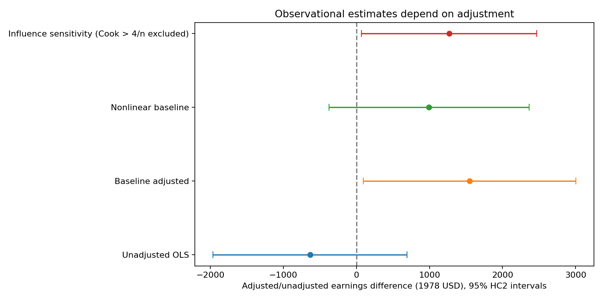
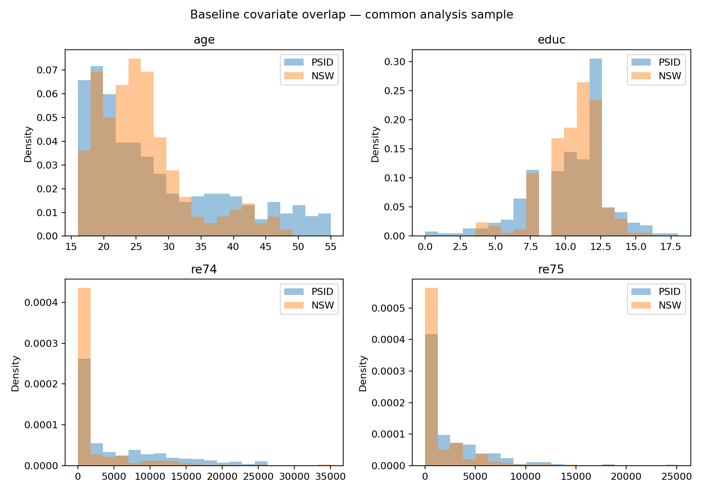

# Employment Program Evaluation — LaLonde

How much does the choice of comparison change the result of an employment-program evaluation? This project uses historical earnings data to compare National Supported Work (NSW) participants with a group from the Panel Study of Income Dynamics (PSID).

The main finding is that the answer changes with the model. Participants earned less in the raw comparison, but the difference turns positive after adjusting for their starting circumstances. Adding nonlinear terms weakens that result.

## Results

The sample contains 614 people: 185 NSW participants and 429 PSID comparison observations. Earnings are measured in 1978 US dollars.

| Comparison | Earnings difference: NSW minus PSID | 95% interval |
| --- | ---: | ---: |
| Raw group means | −$635 | See the Welch interval in [summary.json](reports/summary.json) |
| OLS with baseline controls | +$1,548 | $94 to $3,003 |
| OLS with additional squared terms | +$993 | −$376 to $2,362 |

The raw difference has a Welch p-value of 0.349. For the baseline-adjusted model, the HC2 robust p-value is 0.037.

The sign change matters because these groups were different before the program. Mean 1974 earnings were about $2,096 for NSW participants and $5,619 for the PSID group. The standardized mean difference for the dataset's Black indicator was 1.668. Regression adjusts for the recorded differences, but it cannot account for everything that may have affected participation and later earnings.



The model with squared terms has an interval that includes zero. That makes the positive adjusted result less convincing as a general conclusion: it depends on how the baseline variables enter the regression.

## How the analysis works

The script first checks the data and keeps rows with complete values for earnings, group membership, and the baseline controls. The main comparisons use that same sample.

It then runs a Welch test for the difference in mean earnings and fits OLS with HC2 robust standard errors. Controls include age, education, the source's race indicators, marital status, degree status, and earnings in 1974 and 1975.

Two checks put the regression result in context:

- **Starting differences:** group means, standardized mean differences, and distribution plots show how much the groups overlap.
- **Model sensitivity:** adding squared age, education, and prior earnings terms tests whether a more flexible adjustment changes the estimate. A separate fit excludes 37 observations with Cook's distance above `4/n` to check their influence; it is not the main estimate.



The sensitivity chart uses HC2 OLS intervals throughout. The raw comparison in the JSON also reports a Welch interval, whose endpoints differ slightly because it uses Welch's t degrees of freedom.

## What this can tell us

The PSID comparison group was not randomly assigned alongside the NSW participants. These estimates describe earnings differences under different adjustments; they do not establish how much the program caused earnings to change. Unmeasured differences between the groups remain a concern.

This is also a historical sample. It does not directly answer whether a similar program would work today.

## Run it

Use Python 3.12. The pinned dependencies are in `requirements-lock.txt`; `requirements.txt` lists the direct dependencies.

```bash
python -m venv .venv
source .venv/bin/activate
# On Windows: .venv\Scripts\activate
pip install -r requirements-lock.txt
python analyze.py
```

The first run downloads the CSV into `data/`. To use a local file with the required columns:

```bash
python analyze.py --data path/to/lalonde.csv
```

New results go into `outputs/`: a JSON summary, baseline-balance and sensitivity tables, and three charts. The published results are in [reports/](reports/); they are not overwritten automatically. The root `summary.json` is a copy retained from the earlier project layout.

Run the input and sample-consistency checks with:

```bash
python -m unittest discover -s tests -v
```

GitHub Actions is configured to run those tests and the analysis. The downloader checks its source file against the SHA-256 recorded in `data_provenance.json`, so a changed upstream file requires review. Custom CSVs receive column and value checks instead.

## Data and background

This project applies statistical-analysis skills from WQU DS 07 to a public employment-program dataset. It does not include the course's private applicant data or notebook.

- LaLonde, R. J. (1986). “Evaluating the Econometric Evaluations of Training Programs with Experimental Data.” *American Economic Review*, 76(4), 604–620.
- The LaLonde comparison dataset is also distributed with R's MatchIt package. This script uses the [public CSV mirror](https://raw.githubusercontent.com/robjellis/lalonde/master/lalonde_data.csv).
- Source details and the checksum are recorded in [data_provenance.json](data_provenance.json). Keep the source attribution when reusing the data.
